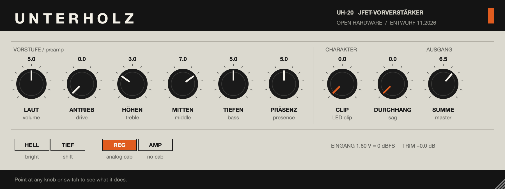

# Unterholz UH-20



**A JFET guitar preamp, published as an open circuit and as a plugin that simulates that circuit.**

The UH-20 has two channels:

- **RHYTHMUS**: a studio-preamp-style clean channel. Glassy, with a sweet second harmonic that grows smoothly as you dig in.
- **LEAD**: a Marshall-style drive channel. It sweeps from edge-of-breakup crunch through creamy, JTM45-style crunch to saturation.

Both channels feed a long-tailed-pair power stage with supply sag. The output is either an analog cab simulation (REC) or the bare amp (AMP).

The goal is a real, buildable amp made of ordinary parts: JFETs, op-amps, LEDs, resistors, capacitors and pots. The plugin exists so you can hear and play the design before building it.

## Download

Get the latest build from **[Releases](https://github.com/ClayShentrup/unterholz-uh20/releases/latest)**:

| Platform | Formats |
|---|---|
| macOS (Apple Silicon + Intel) | VST3, AU, CLAP, standalone app |
| Windows (64-bit) | VST3, CLAP, standalone app |

On macOS you can also install with Homebrew:

```bash
brew install --cask clayshentrup/tap/unterholz-uh20
```

The macOS builds are not notarized yet; `INSTALL.txt` in the download explains the one-time step.

REAPER users can also use [`jsfx/Unterholz UH-20.jsfx`](jsfx/) directly. It is the reference implementation the C++ plugin was ported from and verified against.

## Samples

**[Listen to them in your browser](https://clayshentrup.github.io/unterholz-uh20/#samples)**, one player per sample, or open any file below.

One guitar part, the lead from Broken Ladder's *the puzzle remains* (a Gretsch Duo Jet, recorded straight in), through the UH-20 at ten settings, with the REC (analog cab) output. The only other processing is light compression after the amp (at most 3 dB) and level matching. Each file is named by its knobs. The first is the setting used on the record.

| | Settings |
|---|---|
| 01 | [Rhythm - volume 5, treble 3, middle 7, bass 5, presence 6, master 6.5 (the puzzle remains)](docs/samples/01%20Rhythm%20-%20volume%205%2C%20treble%203%2C%20middle%207%2C%20bass%205%2C%20presence%206%2C%20master%206.5%20%28the%20puzzle%20remains%29.mp3) |
| 02 | [Rhythm - volume 3, treble 5, middle 6, bass 4, presence 5, master 6.5, bright](docs/samples/02%20Rhythm%20-%20volume%203%2C%20treble%205%2C%20middle%206%2C%20bass%204%2C%20presence%205%2C%20master%206.5%2C%20bright.mp3) |
| 03 | [Rhythm - volume 7, treble 4, middle 7, bass 5, presence 6, master 7.5](docs/samples/03%20Rhythm%20-%20volume%207%2C%20treble%204%2C%20middle%207%2C%20bass%205%2C%20presence%206%2C%20master%207.5.mp3) |
| 04 | [Rhythm - volume 8, treble 4, middle 7, bass 5, presence 6, master 8, sag 7](docs/samples/04%20Rhythm%20-%20volume%208%2C%20treble%204%2C%20middle%207%2C%20bass%205%2C%20presence%206%2C%20master%208%2C%20sag%207.mp3) |
| 05 | [Rhythm - volume 6, treble 4, middle 7, bass 5, presence 6, master 7, jubilee 5](docs/samples/05%20Rhythm%20-%20volume%206%2C%20treble%204%2C%20middle%207%2C%20bass%205%2C%20presence%206%2C%20master%207%2C%20jubilee%205.mp3) |
| 06 | [Lead - drive 3, treble 5, middle 6, bass 5, presence 5, master 6.5](docs/samples/06%20Lead%20-%20drive%203%2C%20treble%205%2C%20middle%206%2C%20bass%205%2C%20presence%205%2C%20master%206.5.mp3) |
| 07 | [Lead - drive 5, treble 5, middle 6, bass 5, presence 5, master 6.5](docs/samples/07%20Lead%20-%20drive%205%2C%20treble%205%2C%20middle%206%2C%20bass%205%2C%20presence%205%2C%20master%206.5.mp3) |
| 08 | [Lead - drive 7, treble 5, middle 7, bass 4, presence 6, master 6.5, jubilee 4](docs/samples/08%20Lead%20-%20drive%207%2C%20treble%205%2C%20middle%207%2C%20bass%204%2C%20presence%206%2C%20master%206.5%2C%20jubilee%204.mp3) |
| 09 | [Lead - drive 9, treble 6, middle 6, bass 5, presence 7, master 7, sag 5](docs/samples/09%20Lead%20-%20drive%209%2C%20treble%206%2C%20middle%206%2C%20bass%205%2C%20presence%207%2C%20master%207%2C%20sag%205.mp3) |
| 10 | [Lead - drive 6, treble 6, middle 5, bass 6, presence 5, master 6.5, bass shift](docs/samples/10%20Lead%20-%20drive%206%2C%20treble%206%2C%20middle%205%2C%20bass%206%2C%20presence%205%2C%20master%206.5%2C%20bass%20shift.mp3) |

## The controls

Point at any control in the plugin and the strip at the bottom explains it.

| Knob | What it does |
|---|---|
| **LAUT** (rhythm volume) | Clean-channel gain. Clean up to about 5, edge of breakup at 6-7 |
| **ANTRIEB** (lead drive) | Lead-channel gain: low = crunch, about 5 = creamy crunch, 8-10 = saturated |
| **HÖHEN / MITTEN / TIEFEN** | Treble / middle / bass. Before the gain in RHYTHMUS, after the distortion in LEAD |
| **PRÄSENZ** (presence) | Upper-mid bite from the power stage's feedback loop |
| **JUBILÄUM** (LED clip) | LED clipping ahead of the tone stack, Jubilee-style. 0 = off |
| **DURCHHANG** (sag) | Supply sag: chords squash after the pick, then bloom back |
| **SUMME** (master) | Drive into the power stage. 6.5 is the reference clean tone |

| Switch | What it does |
|---|---|
| **RHYTHMUS / LEAD** | Channel select |
| **HELL** | Bright cap on the rhythm volume |
| **TIEF** | Bass shift into the first stage |
| **REC / AMP** | Analog cab-sim output, or no cab (for a real cabinet or your own impulse response) |

## How it is made

The plugin models the circuit in volts: J201 gain stages, a nodal tone-stack solver, an LED clipper solved per sample, and a power stage with supply sag. It runs at 8x oversampling with 8th-order anti-aliasing filters.

Each design decision is checked against measurements:

- the clean channel's frequency response, harmonic signature and compression against a measured studio preamp;
- the lead channel's compression and harmonics against measured classic amps.

The circuit-level work lives in [`hardware/`](hardware/):

- SPICE netlists of the classic tube stages, built from published schematic values ([`REFERENCE_CIRCUITS.md`](hardware/REFERENCE_CIRCUITS.md));
- each stage's JFET translation, chosen so its transfer curve matches the tube stage's shape (within 0.3-1% so far);
- a full JFET lead path that reproduces the tube preamp's distortion within about 1-2 dB.

[`hardware/DESIGN.md`](hardware/DESIGN.md) tracks the design and its status.

## Building from source

```bash
git clone --recursive https://github.com/ClayShentrup/unterholz-uh20
cd unterholz-uh20
cmake -S . -B build -DCMAKE_BUILD_TYPE=Release
cmake --build build --config Release --target UnterholzUH20_All UnterholzUH20_CLAP
```

You need CMake 3.22+ and a C++20 compiler. JUCE and the CLAP extensions come in as git submodules. Every push is built on GitHub Actions, and every `v*` tag publishes a release.

## License

[AGPL-3.0-or-later](LICENSE). The plugin is built with [JUCE](https://juce.com) under its AGPLv3 option, with [clap-juce-extensions](https://github.com/free-audio/clap-juce-extensions) for CLAP.
